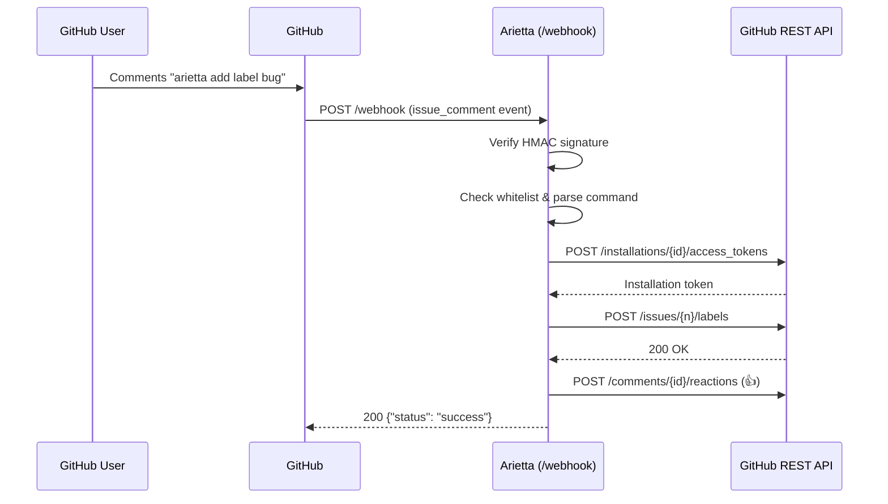

# Arietta

A lightweight GitHub App bot that gives granulated permissions to trusted contributors on personal (non-organizational) repositories. Whitelisted users issue commands via issue/PR comments, and Arietta applies labels or milestones on their behalf — reacting with 👍 on success or 👎 on failure.

No database, no frontend, no background workers — just a single Flask webhook endpoint.

## How It Works

1. **GitHub delivers an `issue_comment` webhook** to `/webhook` whenever someone comments on an issue or PR.
2. Arietta **verifies the HMAC signature** (`X-Hub-Signature-256`) to ensure the payload is authentic.
3. It checks that the comment author is in the **whitelist** and the comment starts with `arietta `.
4. The bot parses the command, authenticates to GitHub via a short-lived **installation access token** (JWT → token exchange), and calls the GitHub REST API.
5. A **thumbs-up/thumbs-down reaction** is added to the comment as feedback.

### Supported Commands

| Command | Example | Effect |
|---|---|---|
| `arietta add label <name>` | `arietta add label bug` | Adds (or creates) the label on the issue/PR |
| `arietta add milestone <name>` | `arietta add milestone v1.0` | Assigns an existing milestone to the issue/PR |

## Project Layout

```
src/arietta/
├── app.py            # Flask app, /webhook route, command parsing, main()
├── __main__.py       # Enables `python -m arietta`
├── arietta.json      # Sample config (not used at runtime)
└── core/
    ├── auth.py       # Webhook HMAC verification, JWT generation, token exchange
    └── action.py     # GitHub REST calls: reactions, labels, milestones
```

## Prerequisites

- **Python 3.12+**
- **A registered GitHub App** with:
  - Webhook URL pointed at your server's `/webhook` endpoint
  - `issue_comment` event subscription
  - Repository permissions: Issues (Read & Write)
  - A generated **private key** (`.pem` file)
  - A configured **webhook secret**

## Setup on a New Server

### 1. Register a GitHub App

1. Go to **GitHub → Settings → Developer settings → GitHub Apps → New GitHub App**.
2. Set the **Webhook URL** to `https://your-server.example.com/webhook` (or use [smee.io](https://smee.io) for local dev).
3. Set a **Webhook secret** — you'll need it for the `GITHUB_WEBHOOK_SECRET` env var.
4. Under **Permissions**, grant **Issues** → Read & Write.
5. Under **Subscribe to events**, check **Issue comment**.
6. Generate and download a **private key** (`.pem` file).
7. Note your **App ID** from the app's settings page.
8. Install the app on the repositories you want to manage.

### 2. Clone and Install

```bash
git clone https://github.com/tvillega/arietta.git
cd arietta

# Using uv (recommended)
uv sync

# Or using pip
pip install -r requirements.txt
```

### 3. Configure Environment Variables

Copy the example and fill in your values:

```bash
cp .env-example .env
```

| Variable | Description |
|---|---|
| `GITHUB_APP_ID` | Your GitHub App's numeric ID |
| `GITHUB_PRIVATE_KEY_PATH` | Path to the `.pem` private key file |
| `GITHUB_WEBHOOK_SECRET` | The webhook secret you configured on GitHub |
| `PORT` | Server port (default `5000`; `.env-example` uses `5050`) |
| `SMEE_URL` | *(dev only)* Your [smee.io](https://smee.io) channel URL |

> [!IMPORTANT]
> The app does **not** load `.env` files automatically (no `python-dotenv`). You must `export` the variables yourself or source the file: `set -a && source .env && set +a`.

### 4. Run

**Development (Flask dev server):**

```bash
export GITHUB_APP_ID=12345
export GITHUB_PRIVATE_KEY_PATH=./private-key.pem
export GITHUB_WEBHOOK_SECRET=your-secret
export PORT=5050

uv run python -m arietta
# or after an editable install:
arietta
```

**Production (Docker Compose):**

```bash
# Place your private key at ./private-key.pem
docker compose up --build
```

This starts:
- **arietta-bot** — the Flask app behind Gunicorn on port 5000
- **smee** — a [smee.io](https://smee.io) sidecar that forwards webhooks to the bot (useful when the server isn't publicly reachable)

> [!NOTE]
> For local development where the bot runs on the host (not in a container), use `docker-compose-smee.yml` instead — it runs only the smee sidecar with host networking, forwarding to `localhost:5050`.

### 5. Update the Whitelist

Edit the `WHITELIST` set in [`src/arietta/app.py`](file:///home/eddyizm/src/arietta/src/arietta/app.py#L21) to include the GitHub usernames allowed to issue commands:

```python
WHITELIST = {"tvillega", "your-username"}
```

## Architecture



## Known Issues

- **Label commands always fail:** `webhook()` passes `"add tag"` as the command type, but `try_catch_action()` compares against `"add label"`. The branch never matches, so the function returns `False` and the bot reacts with 👎. See [`app.py` L88-90](file:///home/eddyizm/src/arietta/src/arietta/app.py#L88-L90).
- **`try_catch_action` always returns `False`:** The success path (line 47) returns `False` instead of `True`, so even milestone commands that succeed get a 👎 reaction.

## License

[AGPLv3+](https://www.gnu.org/licenses/agpl-3.0.html)
