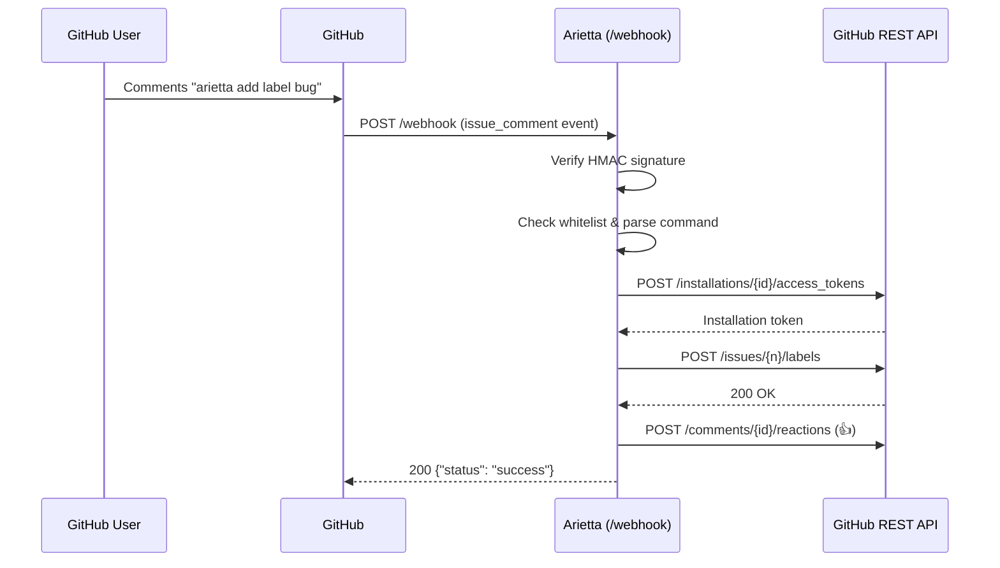

# Arietta

A lightweight GitHub App bot that gives granulated permissions to trusted contributors on personal (non-organizational) repositories. Whitelisted users issue commands via issue/PR comments, and Arietta applies labels or milestones on their behalf — reacting with 👍 on success or 👎 on failure.

No database, no frontend, no background workers — just a single Flask webhook endpoint.

## Why

GitHub's personal repositories work on an all-or-nothing fashion when it comes to permissions for collaborators.
I just wanted to triage issues so I *designed* this solution for others to give me scoped permissions through the bot.

This projects is openly pro-LLM's, however each change made by a model will get harshy reviewed by myself.
A quick win means nothing if I can't understand it. Overengineering is rejected, this must stay simple.

## How It Works

1. **GitHub delivers an `issue_comment` webhook** to `/webhook` whenever someone comments on an issue or PR.
2. Arietta **verifies the HMAC signature** (`X-Hub-Signature-256`) to ensure the payload is authentic.
3. It checks that the repository and comment author are in the configured **whitelists** and that the comment starts with the configured `BOT_NAME` prefix.
4. The bot parses the command, authenticates to GitHub via a short-lived **installation access token** (JWT → token exchange), and calls the GitHub REST API.
5. A **thumbs-up/thumbs-down reaction** is added to the comment as feedback.

### Supported Commands

| Command | Example | Effect |
|---|---|---|
| `arietta add label <name>` | `arietta add label bug` | Adds an existing label to the issue/PR |
| `arietta rm label <name>` | `arietta rm label bug` | Removes a label from the issue/PR |
| `arietta add milestone <name>` | `arietta add milestone v1.0` | Assigns an existing milestone |
| `arietta rm milestone <value>` | `arietta rm milestone v1.0` | Clears the milestone (value ignored) |
| `arietta self assign` | `arietta self assign` | Assigns the commenting user |
| `arietta self unassign` | `arietta self unassign` | Unassigns the commenting user |

## Project Layout

```
src/arietta/
├── app.py            # Flask app, /webhook route, command parsing, main()
├── __main__.py       # Enables `python -m arietta`
├── arietta.json      # Sample config (not used at runtime)
└── core/
    ├── auth.py       # Webhook HMAC verification, JWT generation, token exchange
    └── action.py     # GitHub REST calls: reactions, labels, milestones
```

## Prerequisites

- **Python 3.12+**
- **A registered GitHub App** with:
  - Webhook URL pointed at your server's `/webhook` endpoint
  - `issue_comment` event subscription
  - Repository permissions: Issues (Read & Write)
  - A generated **private key** (`.pem` file)
  - A configured **webhook secret**

## Setup on a New Server

### 1. Register a GitHub App

1. Go to **GitHub → Settings → Developer settings → GitHub Apps → New GitHub App**.
2. Set the **Webhook URL** to `https://your-server.example.com/webhook` (or use [smee.io](https://smee.io) for local dev).
3. Set a **Webhook secret** — you'll need it for the `GITHUB_WEBHOOK_SECRET` env var.
4. Under **Permissions**, grant **Issues** → Read & Write.
5. Under **Subscribe to events**, check **Issue comment**.
6. Generate and download a **private key** (`.pem` file).
7. Note your **App ID** from the app's settings page.
8. Install the app on the repositories you want to manage.

### 2. Clone and Install

```bash
git clone https://github.com/tvillega/arietta.git
cd arietta

# Using uv (recommended)
uv sync

# Or using pip
pip install -r requirements.txt
```

### 3. Configure Environment Variables

Copy the example and fill in your values:

```bash
cp .env-example .env
```

Arietta loads `.env` automatically via `python-dotenv`, so no manual `export` is needed when running from the repository root. Docker Compose reads the same file.

| Variable | Description |
|---|---|
| `GITHUB_APP_ID` | Your GitHub App's numeric ID |
| `GITHUB_PRIVATE_KEY_PATH` | Path to the `.pem` private key file, e.g. `./private-key.pem` |
| `GITHUB_WEBHOOK_SECRET` | The webhook secret configured on the GitHub App |
| `BOT_NAME` | Command prefix without a trailing space (e.g. `arietta`); Arietta appends the space. Required — webhook handling fails if unset |
| `PORT` | Flask dev-server port (default `5000`; `.env-example` uses `5050`) |
| `USER_WHITELIST` | Comma-separated GitHub usernames allowed to issue commands, e.g. `tvillega,your-username` |
| `REPO_WHITELIST` | Comma-separated `owner/repo` names the bot may act on, e.g. `tvillega/arietta`; comments on other repositories are ignored |
| `SMEE_URL` | [smee.io](https://smee.io) channel URL used by `docker-compose-smee.yml` to forward webhooks to a bot running on the host |

### 4. Run

**Development (Flask dev server):**

```bash
# Fill in .env first; it is loaded automatically.
uv run python -m arietta
# or after an editable install:
arietta
```

**Production (Docker Compose):**

`docker-compose.yml` runs only the bot. You bring your own publicly reachable server (e.g. a reverse proxy providing TLS) and set the GitHub App's Webhook URL to `https://your-server.example.com/webhook`.

```bash
# Place your private key at ./private-key.pem
docker compose up --build
```

The bot is reachable on host port `5001` (mapped to container port `5000`); forward your proxy to `localhost:5001`.

> [!NOTE]
> For local development, run the bot on the host (`uv run python -m arietta`, port `5050`) and start only the smee sidecar:
>
> ```bash
> docker compose -f docker-compose-smee.yml up
> ```
>
> It forwards your [smee.io](https://smee.io) channel to `localhost:5050/webhook`.

### 5. Configure the Whitelists

Whitelists are read from the environment. Set them in `.env` (see the table above):

```dotenv
USER_WHITELIST=tvillega,your-username
REPO_WHITELIST=tvillega/arietta,your-username/your-repo
```

`USER_WHITELIST` controls who may issue commands; `REPO_WHITELIST` controls which repositories the bot will act on. Both are comma-separated lists.

## Architecture



## License

[AGPLv3+](https://www.gnu.org/licenses/agpl-3.0.html)
