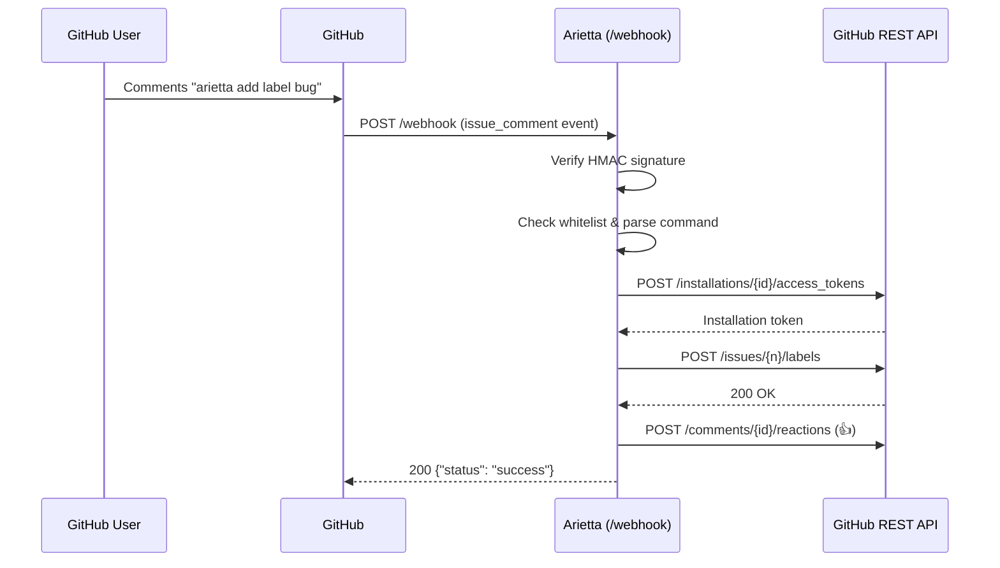

# Arietta

GitHub App bot that gives granulated permissions to trusted contributors on personal (non-organizational) repositories.

## Why

GitHub's personal repositories work on an all-or-nothing fashion when it comes to permissions for collaborators.
I just wanted to triage issues so I *designed* this solution for others to give me scoped permissions through the bot.

## LLM

This projects is openly pro-LLM's, however each change made by a model will get harshy reviewed by myself.
A quick win means nothing if I can't understand it. Overengineering is rejected, this must stay simple.

## How It Works

The user writes a special comment on the issue tracker and Arietta picks it up as a command.

| Command | Example | Effect |
|---|---|---|
| `arietta add label <name>` | `arietta add label bug` | Adds an existing label to the issue/PR |
| `arietta rm label <name>` | `arietta rm label bug` | Removes a label from the issue/PR |
| `arietta add milestone <name>` | `arietta add milestone v1.0` | Assigns an existing milestone |
| `arietta rm milestone` | `arietta rm milestone` | Clears the milestone |
| `arietta self assign` | `arietta self assign` | Assigns the commenting user |
| `arietta self unassign` | `arietta self unassign` | Unassigns the commenting user |

Anything after `--` is ignored by Arietta.

```
arietta self assign -- this will be fun.
```

### Multi-command blocks

Use `do` to run several commands in a single comment.

* List mode:

> Prepend each commands with `- `.

```text
arietta do
- add label bug
- rm milestone
- done
```

* Bash mode:

> Prepend each command with zero or more spaces.

```text
arietta do
  rm label bug
  add milestone Deployment
  self assign
done
```

Anything after `done` is ignored.

```text
arietta do
- self unassign
- rm milestone
- add label wontfix
- done


We've evaluated your issues and we won't proceed with it.
```

Arietta will react with a confused emoji for partial success.

## Project Layout

```
src/arietta/
├── app.py            # Flask app, /webhook route, command parsing, main()
├── __main__.py       # Enables `python -m arietta`
└── core/
    ├── auth.py       # Webhook HMAC verification, JWT generation, token exchange
    └── action.py     # GitHub REST calls: reactions, labels, milestones
```

## Prerequisites

- **Python 3.12+**
- **A registered GitHub App** with:
  - Webhook URL pointed at your server's `/webhook` endpoint
  - `issue_comment` event subscription
  - Repository permissions: Issues (Read & Write)
  - A generated **private key** (`.pem` file)
  - A configured **webhook secret**

## Setup on a New Server

### 1. Register a GitHub App

1. Go to **GitHub → Settings → Developer settings → GitHub Apps → New GitHub App**.
2. Set the **Webhook URL** to `https://your-server.example.com/webhook` (or use [smee.io](https://smee.io) for local dev).
3. Set a **Webhook secret** — you'll need it for the `GITHUB_WEBHOOK_SECRET` env var.
4. Under **Permissions**, grant **Issues** → Read & Write.
5. Under **Subscribe to events**, check **Issue comment**.
6. Generate and download a **private key** (`.pem` file).
7. Note your **App ID** from the app's settings page.
8. Install the app on the repositories you want to manage.

### 2. Clone and Install

```bash
git clone https://github.com/tvillega/arietta.git
cd arietta

# Using uv (recommended)
uv sync

# Or using pip
pip install -r requirements.txt

# To install the package with dev/deploy tooling instead
pip install -e '.[dev,deploy]'
```

### 3. Configure Environment Variables

Copy the example and fill in your values:

```bash
cp .env-example .env
```

| Variable | Description |
|---|---|
| `GITHUB_APP_ID` | Your GitHub App's numeric ID |
| `GITHUB_PRIVATE_KEY_PATH` | Path to the `.pem` private key file, e.g. `./private-key.pem` |
| `GITHUB_WEBHOOK_SECRET` | The webhook secret configured on the GitHub App |
| `BOT_NAME` | Exact command prefix users must type at the start of every comment, without a trailing space (e.g. `arietta`; Arietta appends the space). Comments with any other prefix are ignored. Required |
| `PORT` | Port used by the Flask dev server locally and by Gunicorn inside the container (`.env-example` uses `5050`). In Docker Compose the container listens on `$PORT`, published on fixed host port `5000` |
| `USER_WHITELIST` | Comma-separated GitHub usernames allowed to issue commands, e.g. `tvillega,your-username` |
| `REPO_WHITELIST` | Comma-separated `owner/repo` names the bot may act on, e.g. `tvillega/arietta`; comments on other repositories are ignored |
| `SMEE_URL` | [smee.io](https://smee.io) channel URL used by `docker-compose-smee.yml` to forward webhooks to a bot running on the host |

### 4. Run

**Development:**

```bash
# Fill in .env first
uv run python -m arietta
```

**Production:**

```bash
docker compose up --build
```

> [!NOTE]
> For local development without a public webhook URL run the smee sidecar alongside it:
>
> ```bash
> docker compose -f docker-compose-smee.yml up
> ```
>
> It'll forward your [smee.io](https://smee.io) channel to `127.0.0.1:5000/webhook`

### 5. Configure the Whitelists

Whitelists are read from the environment. Set them in `.env` (see the table above):

```dotenv
USER_WHITELIST=tvillega,your-username
REPO_WHITELIST=tvillega/arietta,your-username/your-repo
```

## Architecture


